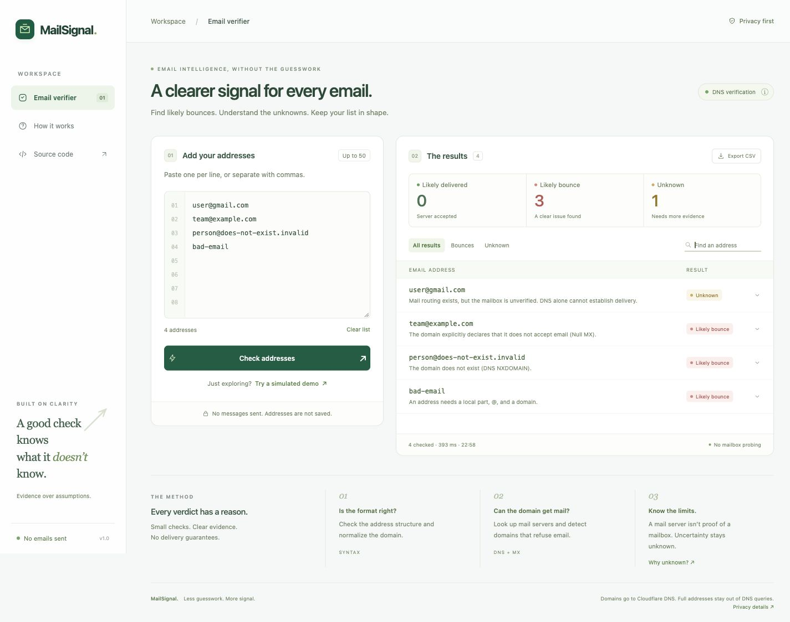

# MailSignal

Email verification for the Shieldnix software development internship assignment. Paste up to **50 addresses** and see **likely delivered**, **likely bounce**, or **unknown**, with evidence for each result. Includes search, status filters, CSV export, and a clearly labelled simulated demo.

**Repository:** [RenzyyyCursors/Emailer](https://github.com/RenzyyyCursors/Emailer)

**Live application:** Add your public Render or Vercel URL here after deployment.



## Run locally

Use Node.js 22.9+ or 24.x. Render uses the tested version in `.node-version`.

```bash
git clone https://github.com/RenzyyyCursors/Emailer.git
cd Emailer
npm start
```

Open [127.0.0.1:3000](http://127.0.0.1:3000). The application has **no runtime dependencies, database, API keys, or required environment variables**. No `npm install` is needed. `npm run dev` restarts the server when code changes.

```bash
npm test       # Offline tests with DNS/SMTP fixtures; no messages sent
npm run build  # Syntax, static asset, UI binding, and API import checks
```

## How verification works

1. Parse addresses separated by newlines, commas, semicolons, or whitespace. Validate supported syntax, preserve local-part case, and normalize international domain names.
2. Query Cloudflare DNS over HTTPS at `https://1.1.1.1/dns-query` for MX records. A single Null MX (`0 .`) explicitly declares no mail service.
3. Resolve mail-server A/AAAA records. When no MX exists, check the domain's A/AAAA address for SMTP's implicit-MX fallback.
4. Return a reason, evidence code, MX records, and separate syntax/domain/routing/mailbox signals. Temporary DNS errors and timeouts stay unknown. Repeated lookups are cached within a batch; concurrency, input size, and query/batch time are bounded.

| Result | Evidence |
| --- | --- |
| **Likely delivered** | An optional **local, owned-address-only** SMTP recipient check was accepted. Acceptance is not a delivery guarantee; catch-all behavior is untested. |
| **Likely bounce** | Invalid syntax, nonexistent domain, Null MX, no usable mail route, or a definite local SMTP `550 5.1.1` mailbox-not-found reply. |
| **Unknown** | Healthy routing without mailbox confirmation, temporary lookup/server failure, ambiguous SMTP response, or unsupported address syntax. |

The API status values are `delivered`, `bounce`, and `unknown`. Plausible quoted local parts, SMTPUTF8 local parts, and address literals are explicitly unsupported/unknown. Duplicate input rows are retained.

**A working Gmail/Outlook domain does not prove a particular mailbox exists.** This is why real, well-routed addresses normally return unknown in the hosted version. The simulated demo uses fictional `.test` addresses, performs no network checks, and marks its results and CSV as simulated.

## Hosting limitations - Render and Vercel

**Both documented hosted versions are DNS-only.** They check syntax, domain existence, Null MX, and mail routing. They cannot confirm mailbox existence, catch-all behavior, inbox placement, spam filtering, or final delivery. Real **likely delivered** results are available only through the optional local SMTP mode; simulation is never presented as live verification.

- **Render Free** [blocks outbound SMTP ports 25, 465, and 587](https://render.com/changelog/free-web-services-will-no-longer-allow-outbound-traffic-to-smtp-ports). MailSignal disables SMTP on Render, even if an ownership allowlist is set.
- **Vercel** [blocks outbound port 25](https://vercel.com/kb/guide/serverless-functions-and-smtp), used to contact receiving mail servers. Its API adapter is always DNS-only.
- **Render Free** [sleeps after 15 minutes of inactivity and takes about a minute to wake](https://render.com/docs/free). This delay is separate from an email check returning unknown.

This follows the assignment's instruction to explain what the deployed version can and cannot check when hosting restricts mail-server connections. It never sends test messages.

## Deploy

See the [step-by-step GitHub, Render, and Vercel guide](docs/DEPLOYMENT.md), including verification and troubleshooting.

| Setting | Render | Vercel |
| --- | --- | --- |
| Type | **Web Service**, Node runtime, **Free** instance | **Other** framework |
| Root directory | Leave blank (repository root) | `./` (repository root) |
| Build command | `npm run build && npm test` | `npm run build` |
| Start command | `npm start` | Managed by the `api/` functions; no start command |
| Output directory | Not needed | `public` |
| Health check | `/api/health` | Open `/api/health` after deployment |
| Environment variables | None to add | None to add |

`render.yaml` supplies the Render Blueprint configuration. `.node-version` pins Render's Node version. The server binds to Render's `PORT` on `0.0.0.0` and handles the public HTTPS origin behind its proxy. `vercel.json` configures Vercel's static frontend and Node API functions. Do not choose `app/` or `public/` as the project root.

After deployment, run this from your local project folder with the **real live URL**:

```bash
npm run verify:deployment -- https://YOUR-SERVICE.onrender.com
# Or: npm run verify:deployment -- https://YOUR-PROJECT.vercel.app
```

It checks the frontend/modules, health API, simulated demo, and live DNS classification without sending any email. Open the final public URL in a private browser window too.

## Optional local SMTP mode

Copy `.env.example` to `.env`, add only complete addresses **you own** to `SMTP_OWNED_EMAILS`, set `SMTP_HELO_HOST`, and restart `npm start`. Your network must permit outbound port 25. This mode binds only to loopback and stays disabled on Render/Vercel.

The adapter uses `EHLO`/`HELO`, an empty return path, and `RCPT TO`, then closes before `DATA`. It never sends message content or random catch-all probes. Private/special-purpose IPs are blocked, connections are pinned to a validated IP, and time/reply sizes are bounded. See [SMTP details](docs/SMTP.md).

## Privacy and limits

The application does not persist address lists, use analytics, or intentionally log request bodies. The API receives the list; only domain/mail-server names go to Cloudflare DNS. Hosting/resolver providers may retain their own infrastructure logs. Reloading clears browser results; clearing the input keeps the previous results until another check or reload.

Results are rendered as text and CSV cells are escaped against formula injection. Rate limiting is best effort per process/function instance; clients behind a proxy can share a quota. It is not a distributed production abuse-control system.

## Submission

After deploying, add the real live link above and generate the required submission document:

```bash
npm run submission -- --live https://YOUR-SERVICE.onrender.com --repo https://github.com/RenzyyyCursors/Emailer
```

Open `submission.html` in a browser and use **Print → Save as PDF**. It contains the live and GitHub links required by the assignment. A [starter PDF](output/pdf/mailsignal-submission-template.pdf) is marked pending; replace it before submitting. An optional direct-PDF utility is available with `python3 -m pip install reportlab`, then `python3 scripts/create_submission_pdf.py --live YOUR_LIVE_HTTPS_URL`. Python is not needed by the app. Read the [interview guide](docs/INTERVIEW.md) before presenting.

## Structure

```text
public/          Browser UI, styles, CSV utility
app/server.mjs   Node web server used locally and on Render
app/src/         Shared checking engine, HTTP/runtime adapters, optional SMTP
api/             Vercel serverless entry points
app/test/        Deterministic tests, including Render HTTPS-proxy regressions
scripts/         Build checks, live deployment verification, submission utilities
docs/            Deployment, SMTP, and interview guides
```

Routing rules: [RFC 5321 section 5.1](https://www.rfc-editor.org/rfc/rfc5321#section-5.1), [RFC 7505](https://www.rfc-editor.org/rfc/rfc7505). Resolver format: [Cloudflare JSON DoH documentation](https://developers.cloudflare.com/1.1.1.1/encryption/dns-over-https/make-api-requests/dns-json/).
